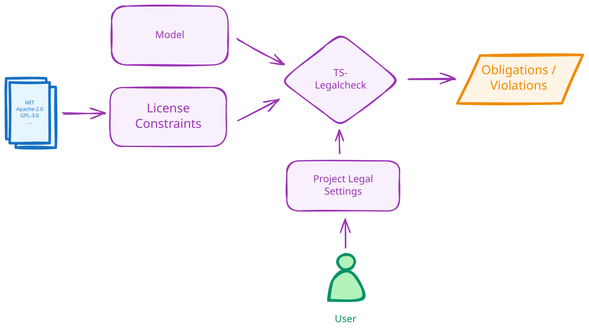
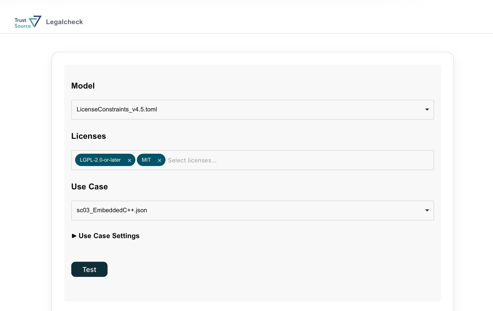
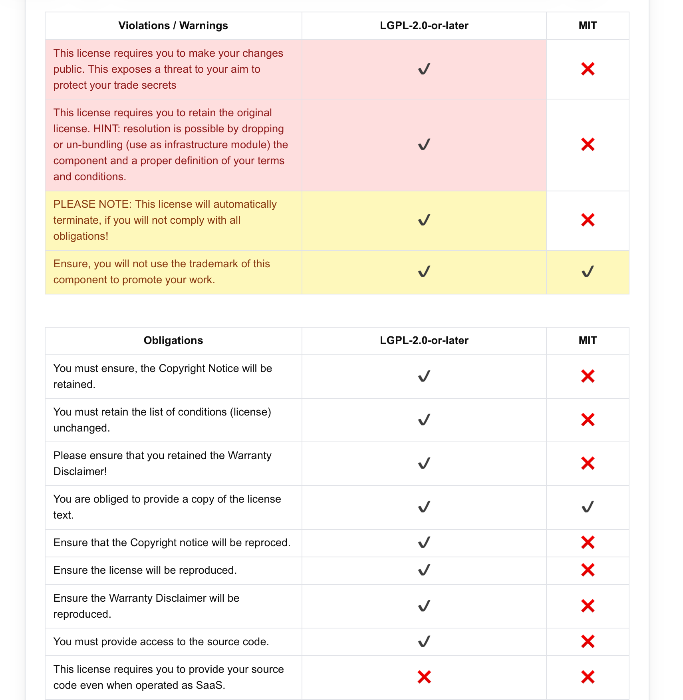

# TS-Legalcheck

**ts-legalcheck** is a tool for automatically checking legal obligations and violations related to the use of software components licensed under one or more open-source licenses within a project. It consists of a powerful constraint engine that uses the state-of-the-art SMT solver Z3, together with several flexible and easily extendable rule sets describing constraints and definitions extracted from various open-source licenses. The internal format for constraints and definitions supports formal definitions without model-specific limitations, making it possible to switch between different models or combine them. One example is the use of the OSADL checklists, available as a model for **ts-legalcheck**, together with a set of violation rules developed by EACG GmbH.

## Introduction

The following diagram represents the main functional principle of **ts-legalcheck**. The tool accepts a model consisting of data extracted from open-source licenses. The model contains known *rights*, *obligations*, and *terms*, as well as rules describing the situations in which certain obligations apply and which conditions may violate license usage.



In addition to a model, the **ts-legalcheck** engine expects user input describing the legal settings of a project. These settings define aspects such as the distribution model, distribution form, and whether third-party components used in the project have been modified. We refer to this input as a use case or legal situation. Based on the model, the legal settings, and the set of open-source licenses used in the project, the engine decides whether the selected licenses can be used in the provided use case and, if so, provides a set of obligations that must be fulfilled.

The different models created by EACG GmbH can be found in the `data/LicenseConstraints_vX.[json|toml]` files, and the OSADL model in the `data/osadl/LicenseConstraints_v1.0.toml` file.

## Installation

**ts-legalcheck** is available as a PyPI package and as a ready-to-use Docker image.

### PyPI

**Requirements**: Python >= 3.10

```bash
pip install ts-legalcheck
```

### Docker

```bash
docker pull trustsource/ts-legalcheck
```

## Usage

### Installed via PyPI

When **ts-legalcheck** is installed from PyPI, it can be used directly as a command-line tool.

#### License Test

The **test** command checks whether a use case violates license usage and, if not, provides a list of obligations that must be fulfilled:

```bash
ts-legalcheck test -l <LICENSE> -d <MODEL LOCATION> <USE-CASE LOCATION>
```

##### Example

The following example tests whether the *Apache-2.0* license can be used in a project with the legal settings from `examples/sc01_ProprietarySoftware.toml` and, if so, which obligations must be fulfilled.

```bash
ts-legalcheck test -l Apache-2.0 -d data/LicenseConstraints_v4.5.toml examples/sc01_ProprietarySoftware.toml
```

### Installed as a Docker image

When **ts-legalcheck** is pulled as a Docker image, it can be executed within a Docker container. For example, the previous command can be run with Docker as follows:

```bash
docker run -it --rm -v ./examples:/examples trustsource/ts-legalcheck test -l Apache-2.0 -d /data/LicenseConstraints_v4.5.toml /examples/sc01_ProprietarySoftware.toml
```

**NOTE**: No extra installation step is required; when this command is executed, the **ts-legalcheck** image is pulled automatically.

### Web UI to test and compare licenses against the project setup

When **ts-legalcheck** is pulled as a Docker image, it can also be executed as a standalone web application. The web UI provides a compact form for selecting the constraint model, one or more licenses, and a use case describing the project's legal settings.



After running the test, the web UI presents the results in tables. Violations, warnings, and obligations are listed row by row, with one column per selected license so that the licenses can be compared against the same project setup.



To run the image as a standalone web application, run the following command:

```bash
docker run -p <HOST_PORT>:5000 trustsource/ts-legalcheck
```

To access the web interface, open `http://127.0.0.1:<HOST_PORT>` in your browser.

The presets shipped inside the Docker image are taken from the repository's `data` folder and are provided as examples. To run the image with custom data, mount a local data directory into the container:

```bash
docker run -p <HOST_PORT>:5000 -v <HOST_DATA>:/data trustsource/ts-legalcheck
```

#### Example: custom use case

To create a new use case, copy an existing use case from `data/use-cases/presets` into the same folder under a new name, adjust the legal settings, and run the Docker container using the following command:

```bash
docker run -p <HOST_PORT>:5000 -v ./data:/data trustsource/ts-legalcheck
```

A new use case will be available in the use-case selector in the app.

**NOTE**: More details on how to extend the data sets, such as adding additional licenses, and detailed descriptions of the formats will be available soon.
